<div align="center">

<picture>
  <source media="(prefers-color-scheme: dark)" srcset="assets/banner.svg">
  <source media="(prefers-color-scheme: light)" srcset="assets/banner-light.svg">
  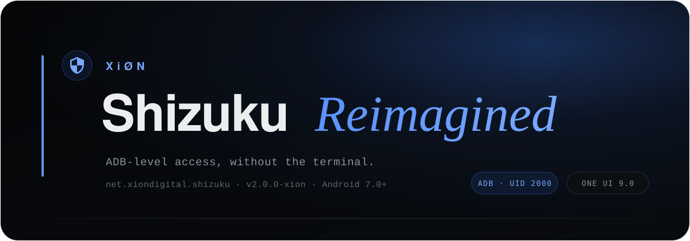
</picture>

<br>

[](CHANGELOG.md)
[](docs/INSTALL.md)
[](docs/INSTALL.md)
[](LICENSE)

**Shizuku's engine. A cockpit that finally tells you the truth.**

[**Download**](https://github.com/XiONDiGiTaL/Shizuku/releases/latest) · [**Project page**](https://xiondigital.net/shizuku) · [**Install**](docs/INSTALL.md) · [**Features**](docs/FEATURES.md) · [**Automation**](docs/AUTOMATION.md) · [**Changelog**](CHANGELOG.md) · [**Report a bug**](https://github.com/XiONDiGiTaL/Shizuku/issues)

</div>

---

Shizuku is the quiet piece of Android tooling that makes ADB-level power available to normal
apps. This fork keeps that engine exactly as it is, then rebuilds everything around it: a
dark-first interface, tools that do real work, and reporting that refuses to lie to you.

It is a replacement, not a companion: install it, authorise your apps in it, uninstall the official
app. Everything Shizuku did, this does. It ships as its own app with its own package, signature and
service, which is what makes the switch reversible and leaves an existing install untouched until
you remove it yourself.

## Three things you notice in the first minute

| | |
|---|---|
| **The truth, first.** Authorised apps are cross-checked against Android's own package manager. If the service says "none" while Android says "24", you get the conflict, not a zero. | **Power where you are.** Package manager, system tweaks and a shell with real exit codes, all running as the service's uid, no terminal needed. |
| **Diagnostics that answer.** Device, One UI build, service privilege, wireless state, authorisation counts, storage, exportable as a report. | **Automation by contract.** Start, stop, restart, watchdog intents and service events, with the auth token right there in the app. |

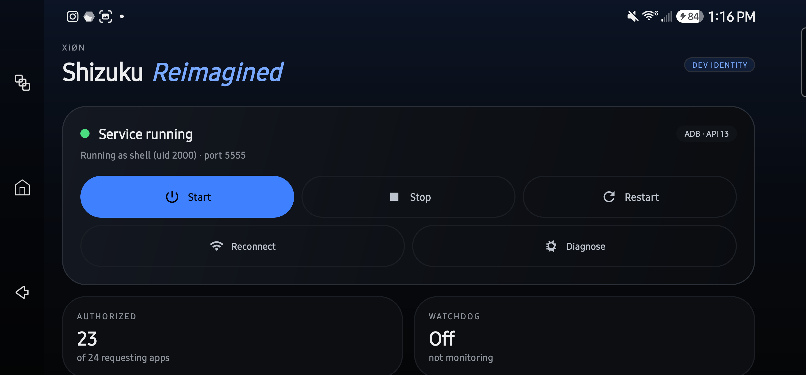

## The bug this fork grew out of

On Android 17 / One UI 9.0, Shizuku 13.6.0 greeted Samsung users with **"Authorized 0
applications"**, while every authorised app kept working. Android 17 changed the signature of the
hidden `getInstalledPackages` call the service uses, so the list came back empty. Authorisation was
never broken; the *reporting* was.

Upstream fixed the call in `e468d70a`. This build starts from that fix and adds a second opinion,
measured on a Galaxy S23 Ultra running One UI 9.0:

| | Official 13.6.0 | Shizuku Reimagined |
|---|---|---|
| Apps listed as authorised | **0** | **23** |
| Permission holders Android reports | 24 | 24 |
| Mismatch handling | silent zero | explicit "reporting failure", with both numbers |

The one-app gap is the official manager itself, which always holds the permission it owns.
Full write-up, evidence and the genuine Samsung limits: [docs/COMPATIBILITY.md](docs/COMPATIBILITY.md).

<table>
<tr>
<td width="50%">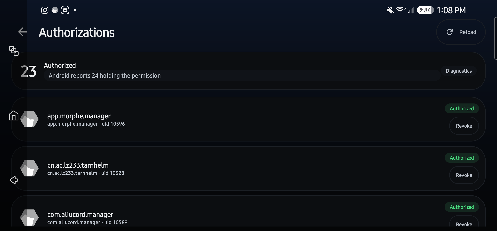<br><sub><b>Authorizations</b>: real list, per-app revoke, live cross-check</sub></td>
<td width="50%">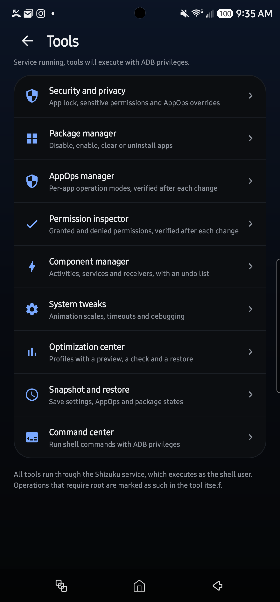<br><sub><b>Tools</b>: packages, AppOps, permissions, command center</sub></td>
</tr>
<tr>
<td>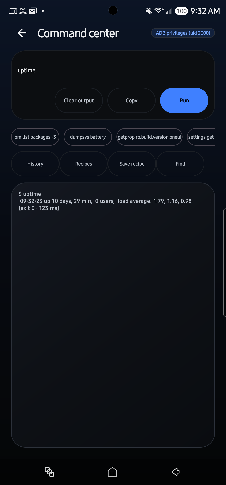<br><sub><b>Command center</b>: exit codes, history, recipes, search</sub></td>
<td>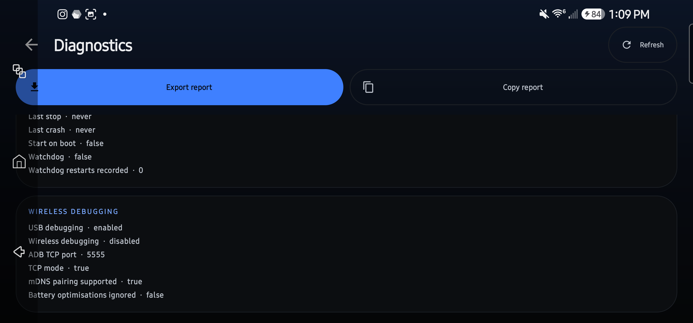<br><sub><b>Diagnostics</b>: device, service, resources, export</sub></td>
</tr>
<tr>
<td>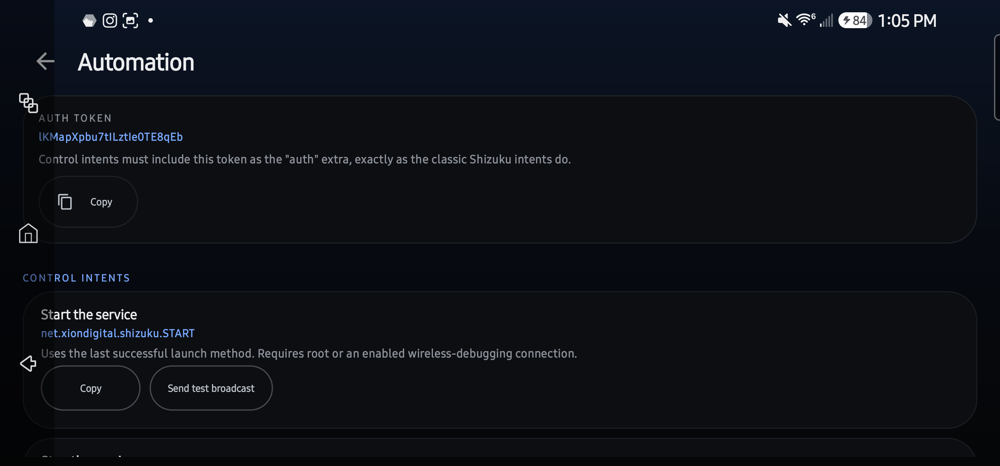<br><sub><b>Automation</b>: intents, events, auth token</sub></td>
<td>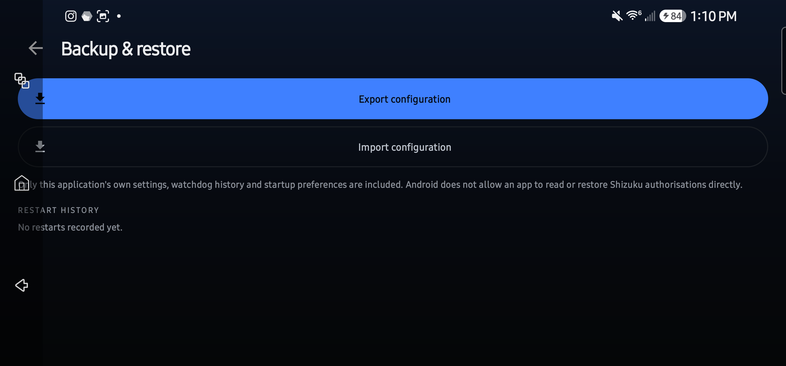<br><sub><b>Backup</b>: export and import app settings</sub></td>
</tr>
<tr>
<td>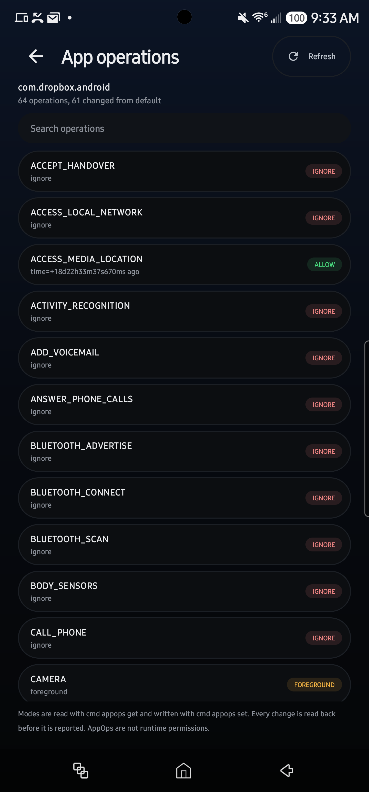<br><sub><b>AppOps manager</b>: per-app operation modes, read back after every change</sub></td>
<td>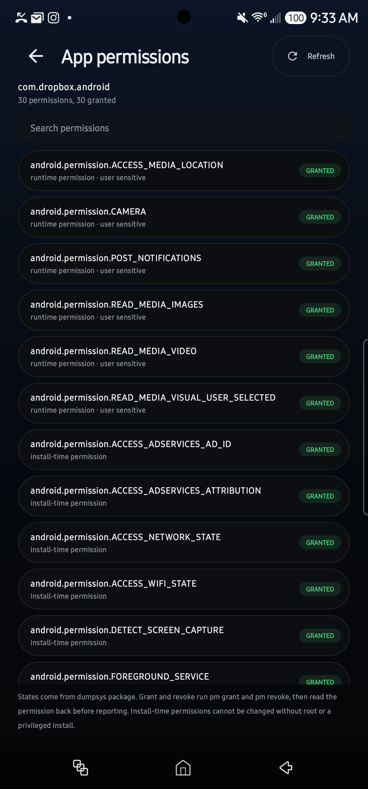<br><sub><b>Permission inspector</b>: runtime permissions, grant and revoke</sub></td>
</tr>
<tr>
<td>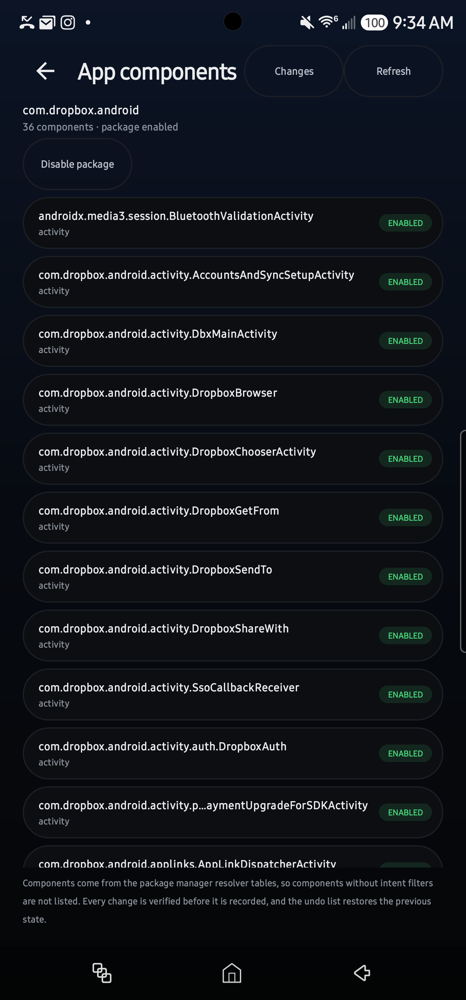<br><sub><b>Component manager</b>: activities, services and receivers</sub></td>
<td>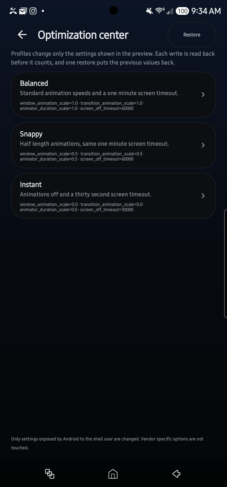<br><sub><b>Optimization center</b>: profiles, preview, one restore</sub></td>
</tr>
<tr>
<td>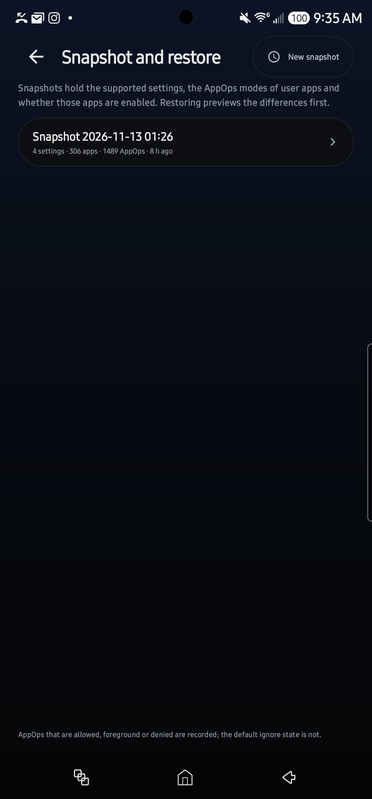<br><sub><b>Snapshots</b>: settings, apps and AppOps with a diff</sub></td>
<td>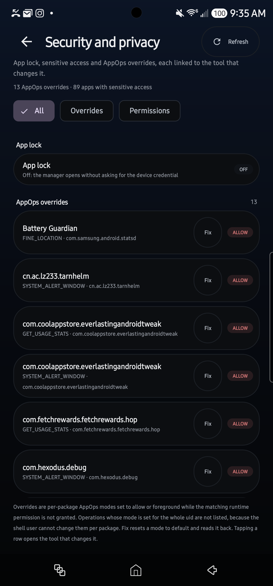<br><sub><b>Security and privacy</b>: overrides with a verified fix</sub></td>
</tr>
</table>

## Designed, not skinned

<sub>XION palette · Sora + Instrument Serif · 18 px cards · One UI-grade controls</sub>

- **Dark first, light supported**, near-black layered surfaces (`#050607`), hairline borders,
  one blue accent (`#3f80ff` → `#79a8ff`), and a light theme with the same hierarchy.
- **Adaptive**, phone, tablet and TV layouts; every screen respects system bars and text scaling.
- **Nothing decorative pretending to be real**, every state shown comes from the service, the
  package manager or the device, and every failure is printed as it happened.

## Two services, zero collisions

| | Official Shizuku | Shizuku Reimagined |
|---|---|---|
| Package | `moe.shizuku.privileged.api` | `net.xiondigital.shizuku` |
| Service process | `shizuku_server` | `xion_shizuku_server` |
| Service config | `shizuku.json` | `net_xiondigital_shizuku.json` |
| Binder fan-out to clients | yes | disabled |

The native starter takes `--server-name=`, so starting this service cannot terminate the official
one. Verified live: both servers running at once, official config byte-identical before and after.

## Install

```bash
adb install -r ShizukuReimagined.apk
```

The file name is the same in every release, so this command never needs editing.

Open the app → **Start** (wireless debugging or root), or start the service from a computer. The app
writes its own `start.sh`, the same way the official Shizuku does, so the command is one line with
nothing to fill in and it works in PowerShell, cmd, macOS and Linux alike:

```bash
adb shell sh /sdcard/Android/data/net.xiondigital.shizuku/start.sh
```

Never used ADB from Windows? [The full guide](site/setup.html) walks through downloading
platform-tools, `adb devices` and authorising the phone, in both PowerShell and cmd. Local copy of
the steps, including how to confirm both services are alive: [docs/INSTALL.md](docs/INSTALL.md).

## Automate it

```bash
adb shell am broadcast -a net.xiondigital.shizuku.START  -p net.xiondigital.shizuku --es auth <token>
adb shell am broadcast -a net.xiondigital.shizuku.STOP   -p net.xiondigital.shizuku --es auth <token>
adb shell am broadcast -a net.xiondigital.shizuku.RESTART -p net.xiondigital.shizuku --es auth <token>
adb shell am broadcast -a net.xiondigital.shizuku.WATCHDOG -p net.xiondigital.shizuku \
  --es auth <token> --ez enabled true
```

Events: `…EVENT.SERVICE_STARTED`, `SERVICE_STOPPED`, `SERVICE_CRASHED`, `SERVICE_RESTARTED`,
`WIRELESS_DEBUGGING`. Token lives in **Automation**. Reference: [docs/AUTOMATION.md](docs/AUTOMATION.md).

## Watched, restarted, reported

Watchdog 2.0 watches the binder instead of hoping: exponential backoff, a hard attempt cap per
15-minute window, restart history, and notifications that separate *recovered* from *gave up*.
Unexpected deaths are recorded with a timestamp and surfaced in diagnostics and automation events.

## Real tools, verified results

Everything under **Tools** runs through the service and reports what happened, not what was attempted.

| Tool | What it does | Verified on the S23 |
|---|---|---|
| Package manager | Disable, enable, clear data and uninstall per app | package disable, then enable again from the recorded undo |
| AppOps manager | Browse and change per-app operation modes | VIBRATE set to allow, restored, read back with `cmd appops get` |
| Permission inspector | Runtime and install-time permissions, grant and revoke | NEARBY_WIFI_DEVICES granted then revoked, confirmed by `dumpsys package` |
| Component manager | Activities, services and receivers, with an undo list | package disable and undo recorded; Android 17 refuses per-component changes for shell and the screen says so |
| Optimization center | Profiles with a live preview and one-tap restore | Instant applied `0.0/0.0/0.0/30000`, restore returned `1.0/1.0/1.0/30000` |
| Snapshot and restore | Settings, package states and meaningful AppOps, with a diff preview | 4 settings, 306 apps and 1489 AppOps captured; a restore moved `0.5` to `1.0` and read back `1.0` |
| Command center | Shell with exit codes, history recall, named recipes and transcript search | `uptime` exited 0, the saved recipe ran again, search reported 2 matching lines |
| Security and privacy | App lock state, sensitive permissions and AppOps overrides with a one-tap reset | 13 overrides and 89 apps with sensitive access; a reset went from 13 to 12 with `default` read back |

No root is used anywhere in that table. The service runs as uid 2000 on the reference device, and
anything Android refuses is shown as refused.

## Verified on a real device

Samsung SM-S918U · Android 17 (SDK 37) · One UI 9.0, over ADB:

- clean build; installed while an official Shizuku was present, without modifying it
  (`pm list packages` showed both during the migration);
- service starts as `xion_shizuku_server` while the official `shizuku_server` keeps running;
- dashboard reports `Service running`, `ADB · API 13`, `uid 2000`, port 5555;
- 23 apps listed, cross-check "Android reports 24 holding the permission";
- shell commands execute with real exit codes; diagnostics collect live device data;
- every screen in the gallery above opened and inspected on the device;
- every tool in the table above was exercised on the device and its result read back from Android,
  not assumed from an exit code.

Not executed in this round: package-manager actions, system tweaks, backup import/export, watchdog
restarts, quick-settings tiles, boot start, TV layout, root start. They are implemented and report
their real result, [docs/FEATURES.md](docs/FEATURES.md) marks each one.

## Documentation

| | |
|---|---|
| [Install](docs/INSTALL.md) | Install, start, migrate off Shizuku, uninstall |
| [Replacement](docs/REPLACEMENT.md) | Scope of a true replacement build under the official package name |
| [Platform](docs/PLATFORM.md) | Non-root platform plan, capability registry and feature status |
| [Features](docs/FEATURES.md) | Every feature with its verification status |
| [Automation](docs/AUTOMATION.md) | Intents, events, tiles, token handling |
| [Diagnostics](docs/DIAGNOSTICS.md) | What the report contains and how to export it |
| [Compatibility](docs/COMPATIBILITY.md) | The One UI 9.0 issue, evidence, Samsung limits |
| [Troubleshooting](docs/TROUBLESHOOTING.md) | Common failures and what to check |
| [Building](docs/BUILDING.md) | Toolchain, signing, native starter |
| [Changelog](CHANGELOG.md) | What changed in 2.0.3-xion |

## Credits

Built on [thedjchi/Shizuku](https://github.com/thedjchi/Shizuku), itself a fork of
[RikkaApps/Shizuku](https://github.com/RikkaApps/Shizuku). The service, the API and the privilege
model are theirs. The interface, tooling, authorisation reporting, watchdog and documentation here
are [XiØN](https://github.com/XiONDiGiTaL)'s.

**Shevery** by [HmnDev-Tech](https://github.com/HmnDev-Tech/shevery), another Shizuku fork, also
Apache 2.0, is where the app lock comes from. Their build asks for biometrics or the device
credential before privileged actions, per action and with configurable timeouts; this build adapts
that idea into a single app-wide switch implemented against Android's own keyguard
(`xion/security/AppLock.kt`, `xion/XionActivity.kt`). Thanks to them for the pattern, and for
showing what else a Shizuku manager can be.

Apache 2.0, same as upstream, see [LICENSE](LICENSE).
